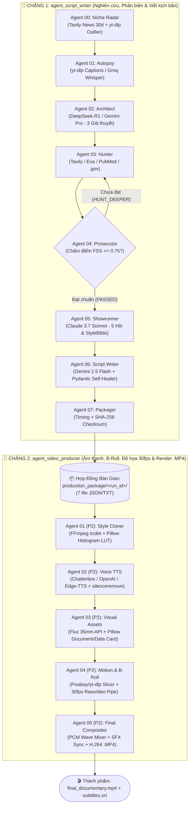

# AI_AGENT_YT — Hệ Thống Sản Xuất Video Tài Liệu & Giải Trí Tự Hành (13 AI Agents)

Kiến trúc toàn hệ thống được phân tách rõ ràng theo đúng tên và nhiệm vụ của từng AI Agent qua 2 giai đoạn độc lập:

```text
AI_AGENT_YT/
├── docs/                                   # Tài liệu thiết kế kiến trúc & đặc tả kỹ thuật
├── run_one_click.py                        # [1-CLICK CLI] Chọn ngách -> Chạy tự động toàn bộ Giai đoạn 1 + 2
├── run_ui.sh                               # Khởi chạy Giao diện Web Mission Control (http://localhost:8501)
│
├── agent_script_writer/                    # === GIAI ĐOẠN 1: AGENT NGHIÊN CỨU, PHẢN BIỆN & VIẾT KỊCH BẢN ===
│   ├── app_mission_control.py              # Giao diện điều khiển Web (Streamlit UI)
│   ├── agents/                             # 8 AI Agents chuyên trách của Giai đoạn 1:
│   │   ├── agent_00_niche_radar/           # Agent 00: Săn ngách ít đối thủ & Video mới nổ (< 45 ngày)
│   │   ├── agent_01_autopsy/               # Agent 01: Tải phụ đề & Mổ xẻ luận điểm video đối thủ
│   │   ├── agent_02_architect/             # Agent 02: Kiến tạo 3 giả thuyết lật ngược (Counter-Hypothesis)
│   │   ├── agent_03_hunter/                # Agent 03: Truy lùng bằng chứng gốc (Tavily/PubMed) & xác minh trích dẫn
│   │   ├── agent_04_prosecutor/            # Agent 04: Công tố viên phản biện chéo & chấm điểm FSS (>= 0.75)
│   │   ├── agent_05_showrunner/            # Agent 05: Lập dàn ý 5 Hồi (MasterPlan) & khóa thực thể (StyleBible)
│   │   ├── agent_06_script_writer/         # Agent 06: Biên kịch chi tiết từng phân cảnh & tự động chữa lỗi
│   │   └── agent_07_packager/              # Agent 07: Đóng gói 7 file xuất xưởng + mã băm SHA-256
│   ├── core/                               # Lõi điều phối (orchestrator, schemas, llm router, timing)
│   ├── tools/                              # Công cụ nền (youtube_autopsy, forensic_search, verify, scoring)
│   ├── scripts/                            # CLI chạy Giai đoạn 1 (run_pipeline.py, validate_package.py)
│   └── production_package/                 # Thư mục chứa gói đầu ra chuẩn của từng Run ID
│
└── agent_video_producer/                   # === GIAI ĐOẠN 2: AGENT SẢN XUẤT ÂM THANH, ĐỒ HỌA & VIDEO ===
    ├── run_phase2.py                       # Bộ điều phối Giai đoạn 2 (có Checkpoint lưu từng cảnh)
    ├── shared/                             # Hợp đồng dữ liệu (contracts.py) & 20 Hồ sơ Kênh (channels.py)
    ├── agent_01_style_cloner/              # Agent 01 (P2): Bóc tách & sao chép DNA dựng phim từ kênh YouTube mẫu
    ├── agent_02_voice_tts/                 # Agent 02 (P2): Phòng thu giọng đọc cảm xúc, Clone giọng & đo timestamp từng từ
    ├── agent_03_visual_assets/             # Agent 03 (P2): Tạo ảnh 35mm (Flux), trang hồ sơ tài liệu & bảng số liệu
    ├── agent_04_motion_broll/              # Agent 04 (P2): Cắt Video B-Roll đúng ngữ cảnh & vẽ đồ họa 30fps
    └── agent_05_final_compositor/          # Agent 05 (P2): Hòa âm SFX theo trigger_word, phụ đề Karaoke & xuất .MP4
```

---

## Biểu Đồ Luồng Xử Lý Toàn Hệ Thống (System Flowchart)


